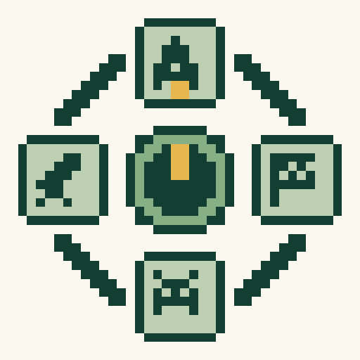
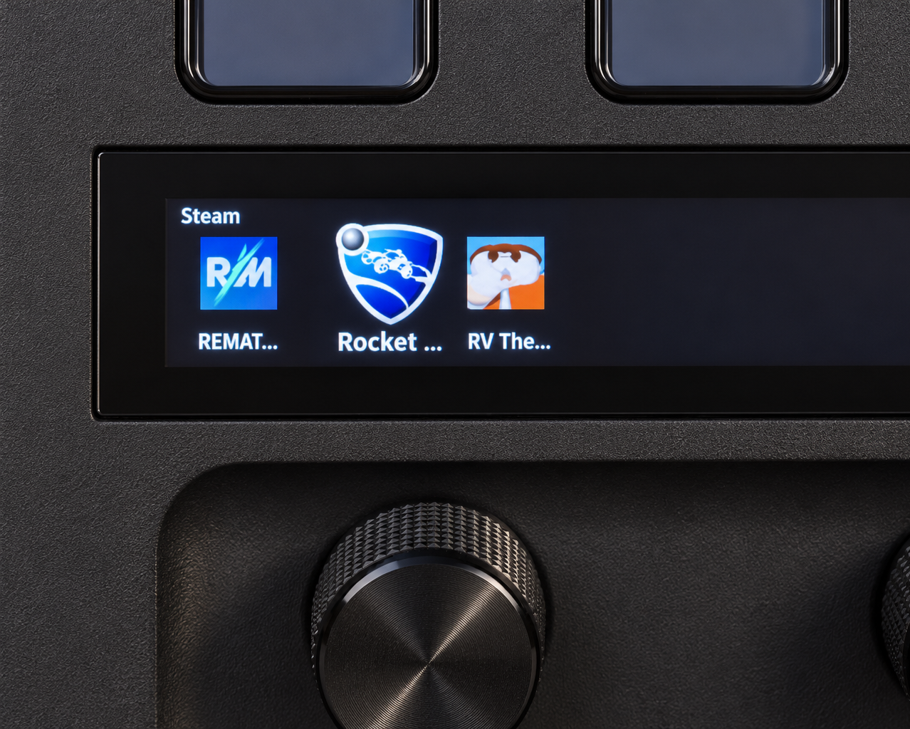
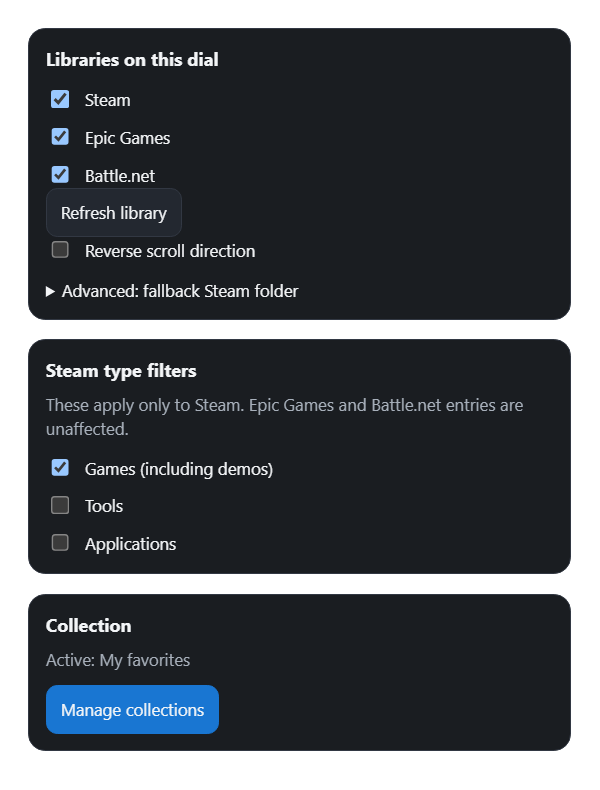
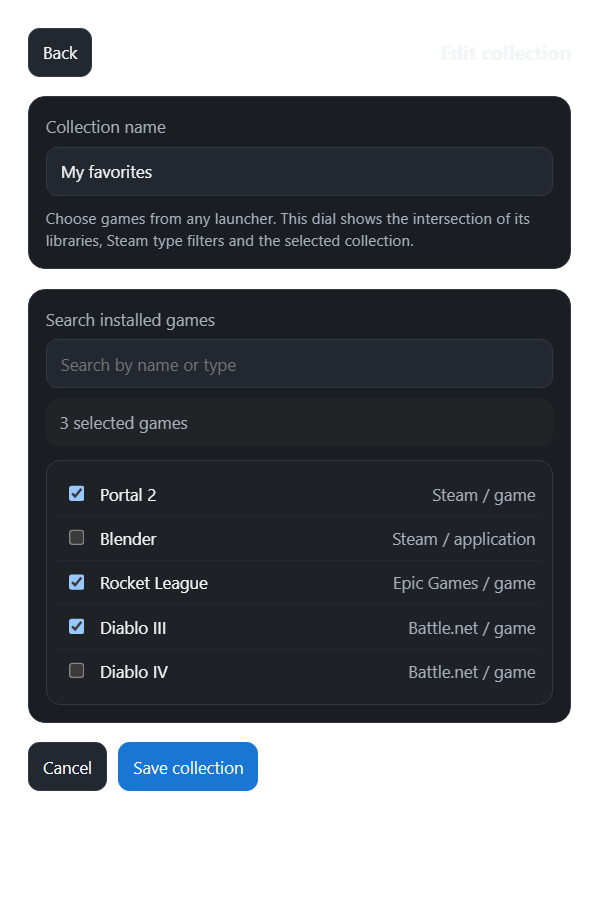

  

<h1 align="center">Game Scroller</h1>

Turn. Choose. Play.

Browse your installed games with a Stream Deck + dial.

Game Scroller, formerly **SteamScroll**, puts your installed games on the dial. Turn to choose a game, then press to launch it through its launcher.

> **Version 3.1.0.0:** the current source and installation package are available in this repository. The Elgato Marketplace listing still provides the earlier SteamScroll release; the rebranding and Marketplace update are pending.

## One dial, your libraries

The new **Game Scroller** action brings **Steam**, **Epic Games** and **Battle.net** together. Select all three, any combination, or just one launcher. Each dial keeps its own selection, collection and scroll direction.

- **Automatic Steam detection:** Steam's registered installation and library folders are found automatically, including libraries on other drives.
- **Local discovery:** Epic and Battle.net games are read from local installation records.
- **Scroll through your games:** browse the library to quickly select the game you want.
- **Click to launch:** Click the dial to launch the game.

## Choose your libraries

Select the launchers to show, refresh the library, or reverse the scroll direction. Steam type filters apply only to Steam games, tools and applications. An optional Steam-folder custom location fallback is available under Advanced.

  

## Keep your favorites together

Create a collection containing games from different launchers. A dial shows games that match both its selected libraries and its chosen collection.

  

Settings previews use an example collection. The device visual is a promotional mock-up based on the real device.

## Launcher support

Games must be installed locally. Launchers handle sign-in, updates and any required prompts. No account credentials are collected by Game Scroller.

## Downloads

- [Download Game Scroller 3.1.0.0](https://github.com/zoran-stefanovic/Game-Scroller/raw/refs/heads/main/com.zstefanovic.steamscroll.streamDeckPlugin)
- [3.1.0.0 release notes](RELEASE-NOTES-3.1.0.0.md)

- [Elgato Marketplace — existing SteamScroll release](https://marketplace.elgato.com/product/steamscroll-fac3f57d-db4b-4fbc-9131-a82a688c8036)
- [GitHub releases](https://github.com/zoran-stefanovic/Game-Scroller/releases)

Download the `.streamDeckPlugin` package for the version you want, then double-click it to install it in Stream Deck.

## Development

Run `npm ci`, `npm run typecheck`, `npm test` and `npm run build`. Automated launch tests use mocks. The runtime requires `appinfoparser.exe` in the plugin bin folder; it is included in the installation package (a ZIP archive). Generated bin files and logs are not tracked. Extract the parser from the package into `com.zstefanovic.steamscroll.sdPlugin/bin/` before packaging a fresh checkout with the Elgato CLI.

See [Battle.net implementation notes](BATTLE-NET.md) for launch limitations.

## Feedback

[Report a problem or request a feature](https://github.com/zoran-stefanovic/Game-Scroller/issues).
